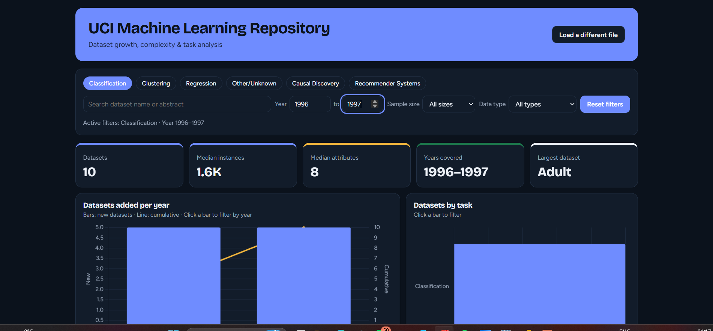
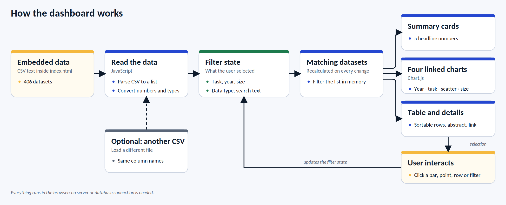

# UCI Machine Learning Repository: Dataset Growth, Complexity & Task Analysis

An end-to-end analysis of 406 datasets from the UCI Machine Learning Repository. I cleaned the data with **Python**, answered analytical questions with advanced **PostgreSQL** queries, and built an interactive **web dashboard** to explore the results.

**[Live dashboard](https://YOUR-USERNAME.github.io/YOUR-REPO-NAME/)** · [Project report](PROJECT_REPORT.pdf)


<!-- TODO: add a screenshot of the web dashboard at images/dashboard.png -->

---

## Table of contents
- [Project overview](#project-overview)
- [Key findings](#key-findings)
- [Workflow](#workflow)
- [Dataset](#dataset)
- [Tech stack](#tech-stack)
- [Repository structure](#repository-structure)
- [How to run](#how-to-run)
- [Data cleaning](#data-cleaning)
- [SQL analysis](#sql-analysis)
- [Web dashboard](#web-dashboard)
- [Limitations](#limitations)
- [Future work](#future-work)
- [Data source and credit](#data-source-and-credit)
- [Author](#author)

---

## Project overview
The UCI repository is one of the most widely used collections of datasets for machine learning. I wanted to understand what it actually contains:

- How quickly has the repository grown, and when?
- Which machine-learning tasks do its datasets support?
- How large and how complex are the datasets, and has that changed over time?
- What kinds of data and attributes are most common?

## Key findings
| Question | Answer |
|---|---|
| Datasets analysed | **406** (389 with a recorded year) |
| Years covered | **1987 to 2018** |
| Busiest year | **2016** (40 datasets), then 2017 (38) and 2014 (37) |
| Share added since 2010 | **63%** of dated datasets (244 of 389) |
| Dominant task | **Classification: 228 datasets (56%)**, then Clustering (73) and Regression (69) |
| Typical size | **About 1,600 instances and 21 attributes** (medians) |
| Largest dataset | Heterogeneity Activity Recognition, **43.9 million** instances |
| Datasets are getting bigger | Median instances rose from **520** (1987 to 1999) to **2,889** (2010 to 2018) |
| Extra Large datasets (over 10,000 rows) | **17%** of 1990s datasets, **37%** of 2010s datasets |
| Wide datasets | **30** datasets (8%) have more attributes than rows |
| Data types | **Multivariate** is the most common (323), then Time-Series (76) and Text (42) |

## Workflow


Python cleans and explores the raw files, the cleaned dataset goes into PostgreSQL for advanced SQL analysis, and the same dataset powers the interactive dashboard. Results are written up in the report and README, and the dashboard is published with GitHub Pages.

## Dataset
Two tables describing each dataset in the repository, joined on the dataset name:

| Table | Columns |
|---|---|
| `uci_table` | name, data_types, default_task, attribute_types, number_of_instances, number_of_attributes, year, sample_size |
| `uci_database` | name, abstract, identifier_string, datapage_url |

`sample_size` groups datasets as Small (10 to 100 rows), Medium (101 to 1,000), Large (1,024 to 10,000) or Extra Large (over 10,000).

## Tech stack
- **Python** in VS Code: pandas for cleaning, matplotlib and seaborn for visualisation
- **PostgreSQL**: advanced queries (window functions, CTEs, percentiles, conditional aggregation)
- **HTML, CSS and JavaScript** with **Chart.js**: the interactive dashboard, built with AI assistance (Claude)
- **GitHub Pages**: hosting the dashboard

## Repository structure
```
.
├── README.md
├── PROJECT_REPORT.pdf
├── index.html                  # interactive dashboard (data embedded)
├── data/
│   ├── UCI_table.csv
│   ├── UCI_database.csv
│   └── uci_cleaned.csv
├── notebooks/
│   └── data_cleaning_and_eda.ipynb
├── sql/
│   ├── create_tables.sql
│   └── analysis_queries.sql
└── images/
    └── dashboard.png
```
<!-- TODO: adjust the folder and file names above to match what you actually upload -->

## How to run
**Python (cleaning and charts)**
```bash
pip install pandas matplotlib seaborn jupyter
jupyter notebook notebooks/data_cleaning_and_eda.ipynb
```

**PostgreSQL**
1. Create the tables with `sql/create_tables.sql`.
2. Load the cleaned CSV with `\copy` from `psql`, using `ENCODING 'UTF8'`.
3. Run the queries in `sql/analysis_queries.sql`.

**Dashboard**
- Open the live link above, or download `index.html` and open it in a browser. It needs an internet connection because it loads Chart.js and fonts from a CDN.

## Data cleaning
Done in Python with pandas:
- Dropped a stray index column and standardised column names to `snake_case`.
- Trimmed extra spaces and collapsed double spaces in names.
- Decoded HTML codes such as `&amp;` and repaired garbled characters caused by an encoding mismatch.
- Converted year, instances and attributes to whole numbers, keeping missing values as blank.
- Treated an attribute count of 0 as missing.
- Standardised attribute type combinations that appeared in different orders.
- Joined the two tables on the cleaned name: all 406 datasets matched an abstract and link.
- Left missing values as NULL instead of guessing them: 17 missing years, 30 missing attribute counts, 14 missing data types and 46 missing attribute types.

## SQL analysis
| # | Question | Techniques |
|---|---|---|
| 1 | How did dataset additions grow each year? Cumulative total, year-on-year change, 3-year rolling average | `SUM() OVER`, `LAG`, window frames |
| 2 | What share of datasets does each task have? | `SUM() OVER ()` |
| 3 | What is the median and 90th percentile size per task? | `PERCENTILE_CONT` |
| 4 | How does the size mix differ by task? | conditional aggregation with `FILTER` |
| 5 | Which dataset is the largest for each task? | `ROW_NUMBER() OVER (PARTITION BY ...)` |
| 6 | How many datasets have more attributes than rows? | filtered counts |
| 7 | Have datasets grown over time? Compare three eras | `CASE`, `PERCENTILE_CONT` |
| 8 | Which attribute types are most common? | CTE, window share |
| 9 | Which data types are most common? | `regexp_split_to_table` |

Full queries and results are in [`PROJECT_REPORT.pdf`](PROJECT_REPORT.pdf).

## Web dashboard
A single `index.html` file with the cleaned dataset embedded, so it works without a server.

- **Summary cards:** datasets, median instances, median attributes, years covered and the largest dataset
- **Filters:** task, year range, sample size, data type and a text search over names and abstracts
- **Linked charts:** datasets added per year with a cumulative line, datasets by task, instances against attributes on log scales, and a sample-size breakdown. Clicking a chart filters everything else.
- **Dataset table:** sortable, and clicking a row shows its abstract and a link
- **Light and dark mode** and a layout that works on phones



## Limitations
- The data is a single snapshot, so it shows what the repository contains and not how often datasets are downloaded or used.
- `default_task` is one label per dataset, but many datasets suit several tasks.
- Some years and attribute counts are missing, so those charts exclude a few datasets.
- Instances and attributes are only weakly related (correlation of the logs is about 0.16), so size alone says little about complexity.

## Future work
- Add download or citation counts to measure which datasets are actually popular
- Group datasets by domain (health, finance, text, sensors) using their abstracts
- Connect the dashboard to a live database instead of embedded data

## Data source and credit
Data comes from the [UCI Machine Learning Repository](https://archive.ics.uci.edu/). Dataset descriptions belong to their original authors and donors. <!-- TODO: add the exact citation UCI asks for -->

## Author
**[Your Name]** · [LinkedIn](https://www.linkedin.com/) · [Email](mailto:you@example.com)
